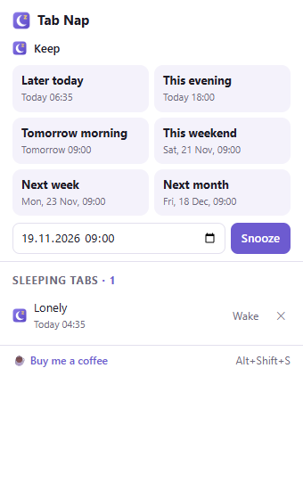

# Tab Nap: Snooze Tabs

**Close a tab now. Get it back exactly when you need it.**

Tab Nap is a tiny Chrome extension for the tabs you can't close yet but don't need right now. Snooze one until this evening, tomorrow morning, the weekend or any date you pick. It closes, and it comes back on time.

[](https://buymeacoffee.com/mehmeteminf)



## Features

- **One click:** Later today, This evening, Tomorrow morning, This weekend, Next week, Next month
- **Any date and time** with the custom picker
- **Right-click a link or page** → Snooze until…
- **Keyboard shortcut:** <kbd>Alt</kbd>+<kbd>Shift</kbd>+<kbd>S</kbd>
- **Sleeping tabs list:** wake one early or forget it
- **Never misses a nap:** tabs that came due while Chrome was closed open the next time you start it
- **Private:** no account, no server, no tracking. Your snoozed tabs stay in your browser's local storage.
- Light and dark mode

## Install

From the Chrome Web Store: *(link coming soon)*

Or from source:
1. Download this repository.
2. Open `chrome://extensions` and turn on **Developer mode**.
3. Click **Load unpacked** and pick the `extension` folder.

## Development

```bash
npm install
npx playwright install chromium
npm test        # time logic unit tests
npm run e2e     # loads the real extension into Chromium and snoozes tabs
```

`npm run e2e` also saves popup screenshots to `e2e/out/`.

Build the Web Store zip on Windows: `powershell -File scripts/pack.ps1`.

## Support

Tab Nap is free. If it saves you from tab overload, you can [buy me a coffee](https://buymeacoffee.com/mehmeteminf) ☕. Bugs and ideas are welcome in [Issues](../../issues).

## License

MIT
